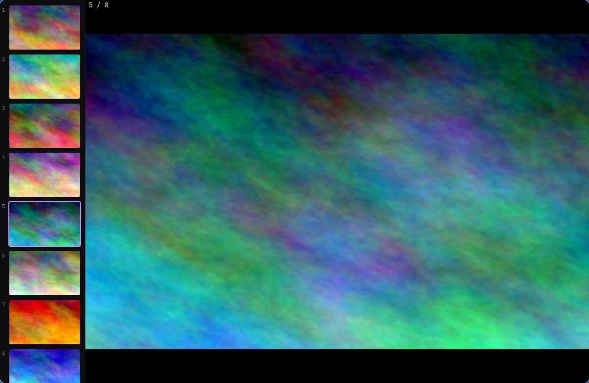

<h1 align="center">imv-strip</h1>

<p align="center">
  Thumbnail-strip image viewer for Omarchy and Hyprland.<br />
  Open one image and the rest of its folder sits in a strip beside it.
</p>

<p align="center">
  <a href="#installation">Install</a>
  ·
  <a href="#keys">Keys</a>
  ·
  <a href="#notes-and-limits">Notes</a>
</p>

<p align="center">
  
</p>

imv-strip is a thumbnail-strip viewer for [Omarchy](https://omarchy.org). It lists every image in the folder in natural order, highlights the current one, and shows an `N / total` counter in the top-left. Left and Right step through the folder and wrap around, the way the slide pane works in PowerPoint.

The viewer is a GTK 4 window written in Python, started by a short Bash launcher. It needs imv, GTK 4 with python-gobject, and Hyprland. The installer checks for all three. No account, API key or network access is needed.

## What you get

- **Every image in the folder, in natural order.** The viewer picks up every file with one of 13 image extensions in the same folder. Subfolders are skipped. Names sort by number, so `img2.png` comes before `img10.png`.
- **Thumbnails load on demand.** Three worker threads decode 144×90 thumbnails, newest request first. Rows that scroll out of view before their turn are skipped. Up to 400 thumbnails stay in memory.
- **Reused thumbnail cache.** If another app has already made a thumbnail in the freedesktop cache, and its modification time still matches the file, the viewer uses that instead of decoding the image again.
- **Neighbours decode ahead.** A background thread decodes the current image, the one before it and the next two, so stepping through the folder usually finds the next image ready.
- **Highlight from your Hyprland border.** The selected thumbnail's ring and number use the first colour of `general:col.active_border`, read with `hyprctl -j`. If that lookup fails, the highlight is `#7aa2f7`.
- **A window rule for one launch.** `imv-dir` opens the viewer through `hyprctl eval`. The window floats, centres at 1200×780 and stays opaque. The rule applies only to that window, and your Hyprland config is not changed.
- **Image actions from your imv keys.** `Ctrl+p` prints through `lp`, `Ctrl+r` rotates with ImageMagick's `mogrify`, and `Ctrl+e` opens omasnap and closes the viewer.
- **EXIF rotation applied.** Full images and thumbnails both apply the embedded orientation tag, so photos from phones and cameras show upright.

## Installation

### Requirements

- Omarchy, or another Hyprland setup. Only Omarchy is tested.
- `imv`, GTK 4 with `python-gobject`, `python3`, and Hyprland's `hyprctl`.
- Optional: JetBrainsMono Nerd Font for the counter and strip labels. Other monospace fonts fall back automatically.

Install the packages:

```sh
sudo pacman -S --needed imv gtk4 python-gobject hyprland
```

### Install

```sh
git clone https://github.com/Anuraj-dev/imv-strip.git ~/Projects/imv-strip
cd ~/Projects/imv-strip
bash install.sh
```

If a dependency is missing, `install.sh` prints the pacman command and exits before it changes anything. It does not run `sudo`.

`install.sh` copies four files into place:

| Installed file | Purpose |
| --- | --- |
| `~/.local/bin/imv-dir` | Launcher. Opens the viewer with the folder loaded. |
| `~/.local/share/imv-strip/imv-strip.py` | The viewer. |
| `~/.config/imv/config` | Plain imv settings for the counter overlay and Ctrl binds. |
| `~/.local/share/applications/imv.desktop` | Desktop entry for common image types. It runs `imv-dir` and does not change your default app. |

Anything it replaces is first copied to `~/.local/state/imv-strip-backup/<timestamp>/`, at the same path relative to your home folder. Nothing is deleted and no packages are installed. The script then checks the installed viewer with `py_compile` and the launcher with `bash -n`.

### Try it

```sh
imv-dir ~/Pictures/some-image.png
```

Run `imv-dir` with no argument to open plain imv.

## Keys

| Key | Action |
| --- | --- |
| `Left` / `Right`, or `h` / `l` | Previous / next image, wraps around |
| `Up` / `Down` | Previous / next image, stops at the ends |
| `Home` / `End` | First / last image |
| `Space` / `Backspace` | Next / previous image |
| `PgUp` / `PgDn` | Previous / next image |
| Click, or `Enter` on a row | Jump to that image |
| `f` | Toggle fullscreen |
| `o` | Open the current image in imv, for zoom and pan |
| `Ctrl+p` | Print the current image |
| `Ctrl+r` | Rotate 90° clockwise, overwriting the file in place |
| `Ctrl+e` | Edit in omasnap, then close |
| `q` / `Esc` | Quit. `Esc` leaves fullscreen first when it is on. |

Trash keys from imv's config are left out on purpose.

## Notes and limits

- The viewer has no zoom or pan. Press `o` to open the current image in imv.
- Animated GIFs show only their first frame.
- `Ctrl+r` rewrites the file. Copy the image first if you want to keep the original.
- The viewer does not read `~/.config/imv/config`. The counter's font and colours and the Ctrl binds are written into the viewer. Editing that file changes plain imv, which `o` and the fallback use.
- `imv-dir` falls back to plain imv only when the viewer file is missing. Outside a Hyprland session it starts the viewer without the window rule, so the window tiles instead of floating and centring.
- Tested on one Omarchy machine only. Other displays and scale factors, such as fractional scaling and multi-monitor layouts, are not tested.

## Uninstall

Each file that `install.sh` replaced is in the newest folder under `~/.local/state/imv-strip-backup/`, at its path relative to your home folder. Copy those files back over the installed ones. Delete any installed file that has no backup copy.

## License

imv-strip is licensed under the [MIT License](LICENSE).
